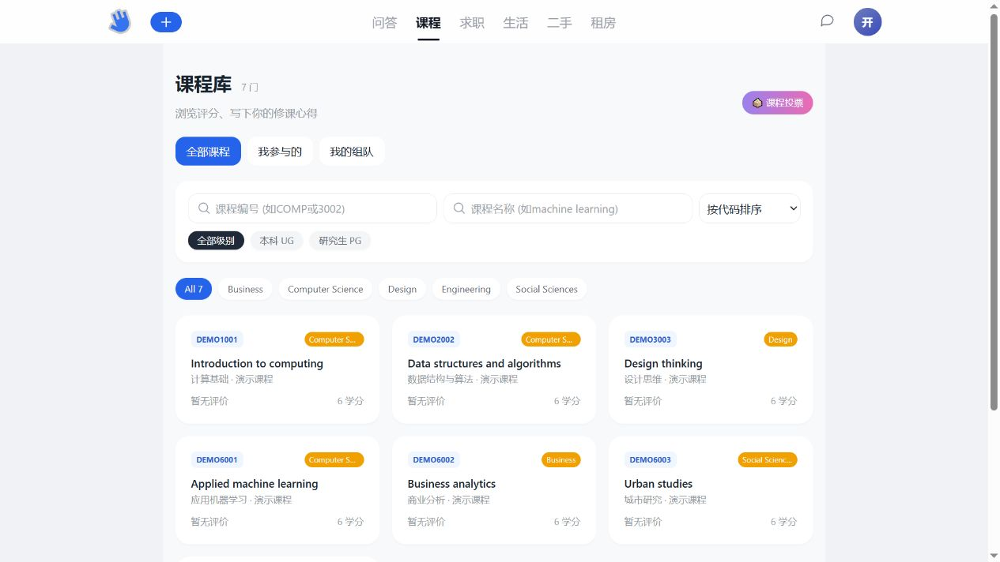
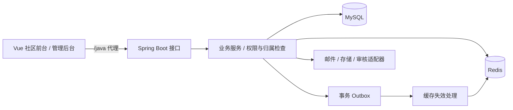

# HKUer Community

一个面向校园交流的全栈社区项目，将问答、课程评价、求职信息、生活分享、二手交易和租房找室友整合到同一套账号与管理后台中。

前端使用 **Vue 3 + TypeScript + Vite**，后端使用 **Java 21 + Spring Boot + MyBatis-Plus**，数据存储采用 **MySQL + Redis**。新社区界面参考 HKUmesh 的页面组织与交互，在原 HKUer 业务服务和管理后台上持续扩展。

> 当前定位为开发与演示项目。包含可运行的前后端、数据库迁移和测试；生产云服务、支付、真实课程数据及全部页面状态验收仍需单独完成。



## 功能

| 模块 | 已实现能力 |
|---|---|
| 问答社区 | 提问、回答、匿名、采纳、同问、蹲帖、点赞收藏、行内评论与本人编辑 |
| 课程库 | 搜索筛选、修课评价、课程投票、分享图、课程资料、参与及组队 |
| 求职与生活 | 分类/地区筛选、多图内容、桌面详情弹窗、手机详情、评论与互动 |
| 二手交易 | 多件图片发布、逐件编辑、收藏、在售/预定/售出、联系卖家 |
| 租房找室友 | 房源、室友与求租信息，地区/预算/习惯匹配，站内联系 |
| 个人与消息 | 资料与技能、徽章、HKU 邮箱认证、本人内容、收藏、通知和私信 |
| 管理后台 | 保留原管理功能，增加社区内容治理、课程与公告管理 |

## 技术结构



- **优先复用**：登录、注册、帖子、点赞、收藏、评论、上传和举报继续使用原服务。
- **按领域扩展**：新功能集中在 `/mesh/*`，管理扩展使用 `/console/mesh/*`，保持原 `Result` 返回规范。
- **数据库版本化**：Flyway 维护 V001–V012 迁移；开发和测试库分离。
- **服务端权限**：匿名内容、私人收藏、组内联系方式、文件归属和管理员操作均由后端校验。
- **互动一致性**：事务、唯一约束和幂等请求处理重复点赞、重复消息及商品发布重试。

## 项目目录

```text
.
├── hkuer/                      # Vue 前端，包含社区前台与原管理后台
│   ├── src/mesh/               # 新社区页面、弹窗和 API
│   ├── src/views/admin/        # 管理后台
│   └── public/                 # 页面所需静态资源
├── backend/hkuer/              # Spring Boot / Maven 项目
│   ├── src/main/java/          # Controller、Service、Mapper
│   ├── src/main/resources/db/mesh/ # Flyway 迁移
│   └── src/test/               # 单元、配置和集成测试
├── config/                     # 无凭据配置模板
├── scripts/                    # 初始化、启动和业务验证
└── docs/                       # 架构、接口、互动一致性及资源说明
```

## 本地启动

### 1. 准备工具

| 工具 | 要求 |
|---|---|
| Node.js | 20.19+ 或 22.12+；项目已在 Node 24 环境构建 |
| Java | JDK 21 |
| Maven | 3.6.3+，`mvn` 可在终端调用 |
| MySQL | 8.0+ |
| Redis | 5+，独立分配开发/测试逻辑库 |
| PowerShell | Windows 启动脚本使用；其他系统可直接运行 Maven/npm |

```powershell
git clone https://github.com/jerry021211/hkuer-community.git
cd hkuer-community
```

仓库公开可访问。下面所有脚本均从仓库根目录运行。

### 2. 初始化私有配置与数据库

```powershell
.\scripts\init-local.ps1
```

脚本生成随机数据库密码、JWT 密钥和管理员密码，写入被 Git 忽略的 `.local/mesh/`；**不连接数据库、不修改现有账号、不覆盖已有配置**。

使用 MySQL 管理员登录，执行生成的 `.local/mesh/bootstrap.sql`（MySQL 客户端中使用 `SOURCE`，路径填写实际克隆目录）。它创建 `hkuer_mesh_dev`、`hkuer_mesh_test` 和仅有这两个库权限的专用用户。若 `hkuer_mesh` 用户已存在，请人工核对或在初始化时指定 `-DatabaseUser` 使用新的专用账号。

确认 Redis 已启动，并在 `.local/mesh/application-local.properties` 配置连接与密码。默认使用：

| 环境 | 后端 | MySQL | Redis |
|---|---|---|---|
| 开发 | `127.0.0.1:9091` | `3306 / hkuer_mesh_dev` | `6379 / DB 2` |
| 测试 | `127.0.0.1:9092` | `3306 / hkuer_mesh_test` | `6379 / DB 3` |

请使用空闲的专用库，不要清空已有项目的数据。若修改测试端口/库，需要同步测试启动脚本和 `HkuerApplicationTests`。

生成配置显式启用本地邮件与本地云服务适配器，便于没有云凭据时开发。源码默认云模式仍为 `aliyun`；真正启用云服务时，按 [配置模板](config/application-local.properties.example) 填写私有凭据并切换模式。

### 3. 启动后端

```powershell
.\scripts\start-mesh-backend.ps1
```

脚本通过 `JAVA_HOME` 或 PATH 查找 Java，通过 PATH 查找 Maven，构建并等待后端就绪。首次启动由 Flyway 自动建表，随后初始化开发管理员。

**使用 IDEA：**打开 `backend/hkuer/pom.xml`，选择 JDK 21，将运行工作目录设为 `backend/hkuer`，运行 `HkuerApplication`。默认读取 `../../.local/mesh/application-local.properties`；设置一次后直接点击运行即可。私有配置位于其他位置时，可设置环境变量 `HKUER_LOCAL_CONFIG`。

### 4. 启动前端

```powershell
cd hkuer
npm ci
npm run dev:mesh
```

- 社区前台：<http://127.0.0.1:5174/home>
- 管理后台：<http://127.0.0.1:5174/admin>
- 管理员用户名：`mesh_admin`，也可使用 `admin@mesh.local` 登录。
- 管理员随机密码：本机 `.local/mesh/secrets.json` 中的 `adminPassword`。

`hkuer/.env.mesh` 将 `/java` 请求代理到 9091。常规 `npm run dev` 同样使用 mesh 模式，但使用 Vite 默认端口 5173。

可选：后端启动后，从根目录执行 `node scripts/seed-mesh-demo.mjs` 创建明确标记的合成演示数据；它会写入开发库，不包含参考网站的用户或业务数据。

## 构建与验证

```powershell
# 前端类型检查与构建
cd hkuer
npm run build:mesh

# 后端构建；完整测试需要先准备独立测试库和 Redis DB 3
cd ../backend/hkuer
mvn test
mvn -DskipTests package
```

无需数据库的单元/配置测试：

```powershell
mvn "-Dtest=JwtAuthenticationFilterTest,LikeServiceImplTest,PayServiceImplTest,ViewCountBatchWriterTest,CloudServicesConfigurationTest,MailModeConfigurationTest,CloudServicesTest" test
```

业务冒烟测试从根目录运行，固定访问 9092：

```powershell
.\scripts\start-mesh-backend.ps1 -Test -SkipBuild
node .\scripts\smoke-mesh.mjs
node .\scripts\smoke-mesh-domains.mjs
```

测试覆盖登录鉴权、匿名可见性、点赞/收藏幂等、课程评价、组队权限、文件归属、二手发布、租房匹配、私信、资料隐私与密码重置等流程。测试会创建合成记录，使用测试库而非开发库；不要把测试配置指向生产数据。

真实云服务测试默认关闭。只有主动启用 `CloudServicesLiveTest` 并提供有效私有配置时，才会访问外部服务。

## 运行模式与当前边界

| 能力 | 本地配置的行为 |
|---|---|
| 邮件 | 验证码写入 `.local/mesh/mail/`；不向真实邮箱发信 |
| 文件 | 本地模式写入 `.local/mesh/uploads/`；云模式使用 OSS |
| 审核 | 本地适配器直接通过，只供 localhost 开发；云模式调用真实审核 |
| 翻译 | 本地模式返回未配置，不生成假译文 |
| RabbitMQ | 默认不启动监听；Outbox 本地处理缓存失效 |
| 支付 | 原代码保留，当前开发配置禁用支付网关 |

前端仍有编辑器/主入口的大分包警告。课程目录需要导入获授权的真实数据；部分参考页面的非空管理、认证结果与下载状态尚未完成一一对照。仓库不声明与参考网站全站逐像素一致，也不宣称可以直接部署到公网生产使用。

## 文档与提交范围

- [架构与开发约定](docs/architecture.md)
- [接口分组与复用](docs/api-overview.md)
- [互动数据一致性](docs/interaction-consistency.md)
- [第三方资源说明](docs/assets.md)

仓库保留运行所需源码、静态资源、依赖锁文件、迁移、测试及配置模板。数据库文件/导出、密码、云凭据、验证码邮件、用户上传、日志、IDE 文件、`node_modules`、`target`、`dist`、本机备份和临时抓取材料均不提交。原后台与兼容页面属于有效代码，继续保留。

此仓库是当前工作区的整理快照，不携带原 Gitee 仓库历史，以免历史配置或凭据进入新仓库。第三方资源的来源和使用边界见资源说明；尚未额外声明开源许可证。
